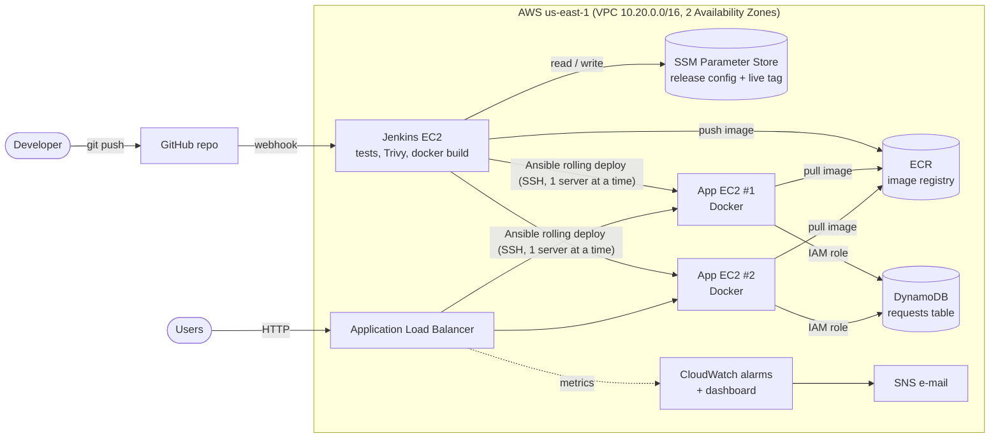
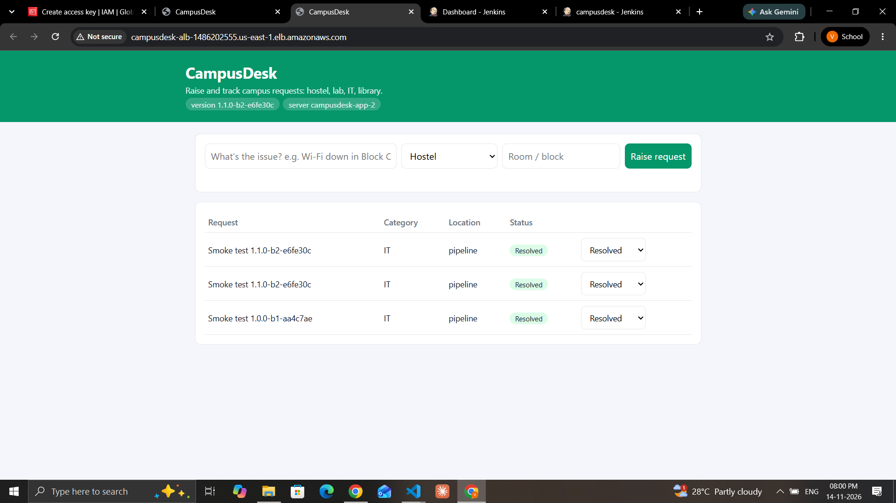
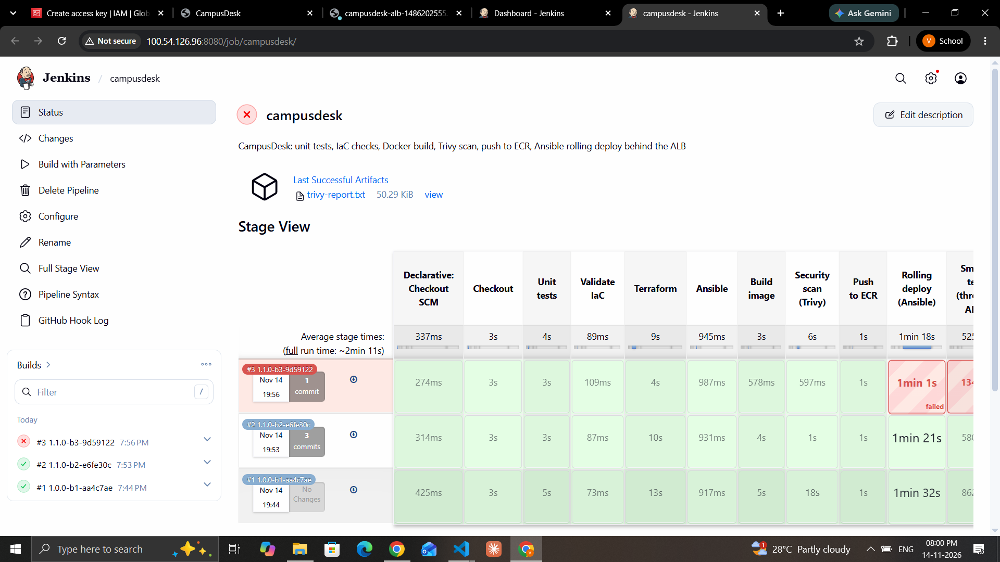
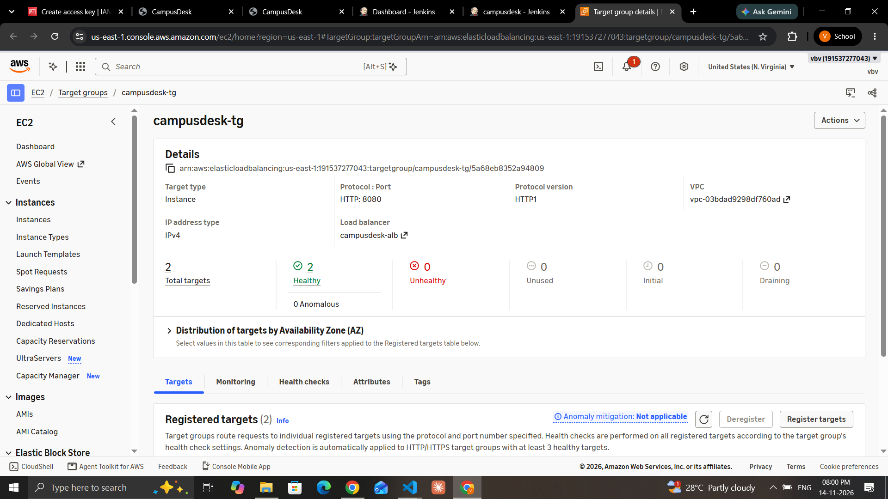
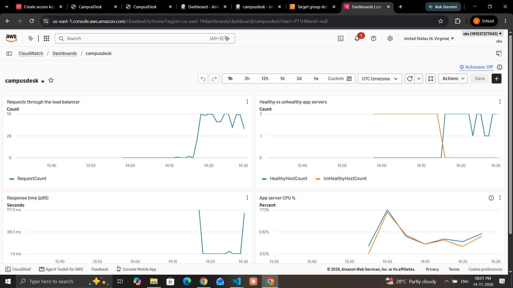

# CampusDesk: automated zero-downtime deployment on AWS

**Vaibhav Naiyar (RA2311003010314)**: Major project, 21IPE333P Essentials in Cloud and DevOps, SRM Institute of Science and Technology

CampusDesk is a small web app where students raise and track campus requests (hostel, lab, IT, library).
The point of the project is **how it is delivered**: one `git push` tests, scans, packages and rolls out a new version to AWS,
**without the site going down**, and **rolls back automatically** if the new version is unhealthy.

| Required tool | Used for |
|---|---|
| **AWS** | VPC, EC2 (Jenkins + 2 app servers), Application Load Balancer, ECR, DynamoDB, IAM roles, SSM Parameter Store, CloudWatch alarms + dashboard, SNS, Budgets |
| **Git / GitHub** | Source of truth; a webhook triggers Jenkins on every push to `main` |
| **Jenkins** | CI/CD pipeline ([`Jenkinsfile`](Jenkinsfile)), itself configured as code (JCasC) |
| **Terraform** | Creates all 45 AWS resources ([`terraform/`](terraform)) |
| **Ansible** | Configures the servers and performs the rolling deploy ([`ansible/`](ansible)) |
| **Docker** | Packages the app as a hardened, non-root image stored in ECR ([`app/Dockerfile`](app/Dockerfile)) |

## Architecture



## The pipeline

| # | Stage | What happens | Fails the build when |
|---|---|---|---|
| 1 | Checkout | Tag = `<version>-b<build>-<commit>`, release settings read from SSM | |
| 2 | Unit tests | `npm ci`, `node --test` with coverage, `npm audit` (in a `node:20-alpine` container) | a test fails / high-severity dependency issue |
| 3 | Validate IaC | `terraform fmt -check` + `validate`, `ansible-playbook --syntax-check` (in parallel) | IaC is broken or unformatted |
| 4 | Build image | Multi-stage Docker build | |
| 5 | Security scan | Trivy: HIGH/CRITICAL vulnerabilities with a fix available | any are found |
| 6 | Push to ECR | Immutable tag, scan-on-push | |
| 7 | Rolling deploy | Ansible, one server at a time (see below) | a server's new version is unhealthy |
| 8 | Smoke test | 10 × `/health` through the ALB must show the new version; create → list → update a request | anything is wrong |
| 9 | Mark release live | `live_tag` written to SSM (used for the next rollback) | |
| post | **Rollback** | On failure after the deploy started: Ansible re-deploys the previous live tag everywhere | |

### Zero-downtime rolling deploy ([`ansible/deploy.yml`](ansible/deploy.yml))

For each app server in turn (`serial: 1`):

1. Pull the new image (while the server is still serving).
2. Deregister it from the ALB target group and wait for in-flight requests to drain (15 s).
3. Start the new container (non-root, read-only filesystem, all Linux capabilities dropped, memory-limited) and check `/health` on the server.
4. **Healthy:** register it again and wait until the ALB marks it healthy; only then move to the next server.
5. **Unhealthy:** start the previous version again, put the server back, and stop the rollout. The other server was never touched, so users never notice.

The other server keeps serving the whole time, so the site never goes down.

## Security by design
- **No access keys on any server:** EC2 instance roles give each server only what it needs (app: DynamoDB table + ECR read; Jenkins: ECR push, target-group register/deregister, `/campusdesk/*` parameters).
- **Network:** the app port only accepts traffic from the ALB's security group; Jenkins is reachable only from the admin IP and GitHub's webhook ranges; SSH is key-only, root login off, fail2ban on.
- **Data:** encrypted EBS volumes, DynamoDB encryption and point-in-time recovery, IMDSv2 required.
- **Supply chain:** Trivy gate in CI, ECR scan-on-push, immutable image tags, `npm audit`.
- **Jenkins:** no setup wizard; admin user, security and the job are defined in code ([`casc.yaml.j2`](ansible/roles/jenkins/templates/casc.yaml.j2)); the admin password is generated and never stored in git.
- **Cost guard:** an AWS Budget alerts at 80 % of $5/month, and burstable instances use `standard` CPU credits.

## Monitoring
CloudWatch dashboard `campusdesk` (requests, healthy/unhealthy servers, p95 latency, CPU) and alarms → SNS e-mail:
an **unhealthy app server**, **more than 10 HTTP 5xx in 5 minutes**, and **CPU > 80 %**.

## Repository layout
```
app/          Node.js 20 + Express app, tests, Dockerfile
terraform/    VPC, security groups, IAM, EC2, ALB, ECR, DynamoDB, SSM, CloudWatch, SNS, Budget
ansible/      dynamic AWS inventory, site.yml (server setup), deploy.yml (rolling deploy), roles/
scripts/      up.sh / down.sh (one-command start/stop), smoke-test.sh, watch-downtime.sh, jenkins-build.sh
Jenkinsfile   the CI/CD pipeline
```

## How to run it

Prerequisites: an AWS account, AWS CLI configured, Terraform ≥ 1.6, Ansible with the `amazon.aws` collection and boto3.

**Quick path:** `scripts/up.sh --deploy` builds everything and runs the first pipeline (about 12 minutes);
`scripts/down.sh` destroys it all and confirms nothing is left running. The steps below are what those scripts do.

```bash
# 1. Infrastructure (about 4 minutes)
cd terraform
cp terraform.tfvars.example terraform.tfvars      # set alert_email
terraform init && terraform apply

# 2. Configure the servers (Jenkins with plugins/job/admin, Docker, hardening)
cd ..
export ANSIBLE_CONFIG=$PWD/ansible/ansible.cfg
ansible-playbook ansible/site.yml
cat ~/.campusdesk/jenkins-admin-password          # Jenkins login: admin / this password

# 3. GitHub -> Settings -> Webhooks -> add  `terraform output github_webhook_url`  (content type: application/json)

# 4. Push to main and watch the pipeline; prove zero downtime while it deploys:
scripts/watch-downtime.sh "$(cd terraform && terraform output -raw app_url)" 300

# 5. Rollback demo: Jenkins -> campusdesk -> Build with Parameters -> SIMULATE_BAD_RELEASE

# 6. Tear everything down
cd terraform && terraform destroy
```

## Results (14 Nov 2026, us-east-1)

| Build | Release | Outcome |
|---|---|---|
| #1 | `1.0.0-b1-aa4c7ae` | ✅ All stages green: first release deployed to both servers |
| #2 | `1.1.0-b2-e6fe30c` (new green theme) | ✅ Rolling deploy with **0 failed requests** while users were served |
| #3 | `1.1.0-b3-9d59122` with `SIMULATE_BAD_RELEASE` | ❌ by design: health check failed on app-1, **automatic rollback**, **173 requests, 0 failed** |

**Automatic rollback (build #3)**, from the Jenkins console:
```
msg: 1.1.0-b3-9d59122 failed its health check on campusdesk-app-1; server restored to 1.1.0-b2-e6fe30c, rollout stopped.
campusdesk-app-1 : ok=13 changed=7 unreachable=0 failed=1 skipped=0 rescued=1     <- app-2 was never touched
ROLLBACK: restoring 1.1.0-b2-e6fe30c on every server
SMOKE TEST PASSED
ROLLBACK COMPLETE: 1.1.0-b2-e6fe30c is live again
```
and from `scripts/watch-downtime.sh`, hitting the site twice a second during the whole failed release:
```
==== FINAL ====
19:59:26  requests: 173  ok: 173  FAILED: 0  | versions served: 1.1.0-b2-e6fe30c x173
RESULT: ZERO DOWNTIME (0 failed requests)
```

**Idempotent configuration:** a second `ansible-playbook ansible/site.yml` run reports `changed=0 failed=0` on all three servers.

### Screenshots

**The app, version 1.1.0, served through the ALB by `campusdesk-app-2`, with data in DynamoDB**


**Jenkins Stage View: builds #1 and #2 green; #3 stopped at the rolling deploy and rolled back**


**Load balancer target group: 2 healthy app servers**


**CloudWatch dashboard: healthy hosts dip from 2 to 1 during each rolling deploy while requests continue**


## Known limitations / next steps
- The ALB serves plain HTTP; production would add a domain, an ACM certificate and an HTTPS listener.
- Terraform state is local; a team would use an S3 backend with locking.
- Instances sit in public subnets (no NAT gateway, to stay within free tier); production would use private subnets.
